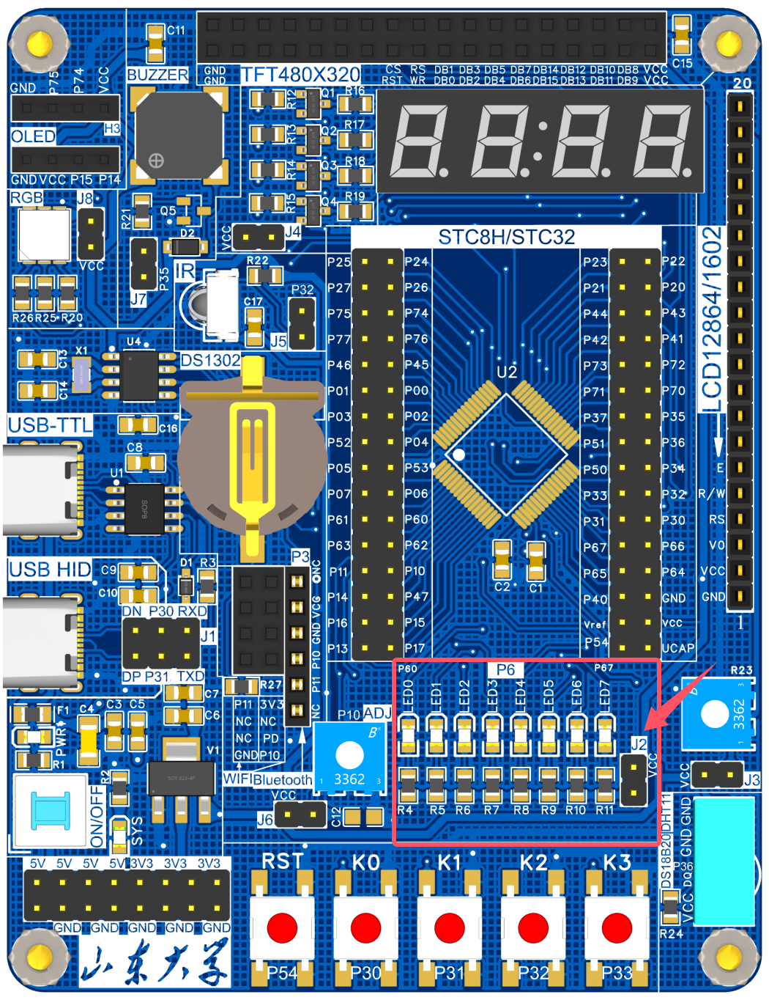

## 功能：

​	本例程实现P6口上连接的1个LED循环发光，实现LED闪烁的效果

## 硬件连接：

​	需要用跳线帽短接J2，给LED模块提供电源

## 程序结构说明：

本例程采用官方库制作，采用了时间片轮询的方式，重新进行了程序架构的整理

本项目分为以下几个文件组（文件夹）：

- user：用户主程序组，基于各应用实现进行项目的集成实现
- app：应用文件组，主要实现基于设备驱动的各应用实现，一般每个任务一个C文件和一个对应的头文件，除了每个应用对应的文件对之外，本文件夹有一个app.c的文件，用于时间片轮训的任务定义
- ChipDevices：片内设备驱动，一般设计好的相关驱动即使不用也可以放进来，使用哪个调用哪个即可，内部文件一般不可修改
- UserDevices：片外设备驱动，一般设计好的相关驱动即使不用也可以放进来，使用哪个调用哪个即可，内部文件一般不可修改
- ISR：中断服务相关，使用哪个中断，在相应的中断服务函数里编写相应的函数内容即可

