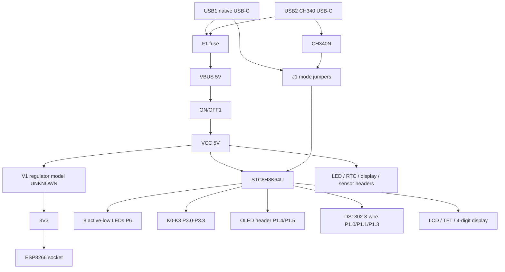

# Hardware Architecture

依据：开发板原理图.pdf第1页，配合图片/1-19.png逐模块检查。

VBUS与VCC应区分：电源指示在VBUS，系统指示在VCC，CH340N由VBUS供电；关闭ON/OFF不能默认断开CH340。两个USB +5V在F1前共网，未见两路电源隔离器件。P1是输出排针，不能自动视为受保护VIN。备用电池B1供DS1302 VCC1；主VCC供VCC2。V1型号UNKNOWN，不能声明其最大电流或保护能力。

MCU电源与ADC_VRef+都为VCC，GND共地；UCap仅去耦。C1/C2等供核心去耦；RST1接P5.4/GND；主时钟采用内部IRC配置，板上X1属于RTC。

## 总线与接口

| 接口 | 连接 | 约束 |
|---|---|---|
| UART1 / USB | P3.0/P3.1 -> J1 -> CH340N或USB1 | J1互斥；K0/K1冲突 |
| UART2 | P1.0 RX、P1.1 TX -> WiFi/蓝牙插座 | RTC和电位器共用；J6及插接设备按功能隔离 |
| I2C | P1.4 SDA、P1.5 SCL -> OLED1 | 控制器/地址UNKNOWN |
| RTC三线 | P1.0 SCLK、P1.1 IO、P1.3 CE | DS1302不是I2C/SPI标准替代件 |
| LCD并行 | P2.0-P2.7，RS=P4.1、RW=P4.2、E=P4.4、RST=P4.5 | 与TFT/数码管冲突 |
| TFT16位并行 | D0-D7=P2.0-P2.7；D8-D15=P0.7-P0.0；CS=P4.4、RS=P4.5、WR=P4.2、RST=P4.1 | SPI相关接口脚NC；控制器UNKNOWN |
| 4位共阳数码管 | a-dp=P2.0-P2.7；Q1-Q4位选=P7.4-P7.7 | J4；PNP位选低有效；不可替换成TM1637协议 |
| RGB | P7.4/5/6，经1k电阻，共阳J8 | 与位选/超声波共用 |
| 超声波插座H3 | 信号P7.4/P7.5、VCC/GND | 未确认装配型号；模拟HC-SR04需明确假设 |
| 蜂鸣器 | P3.5 -> J7/R21 -> Q5 S8050 ->蜂鸣器 | 2700Hz标注；模型不含驱动电流 |
| 单总线/温湿度 | P3.6，10k上拉，插座供VCC | DS18B20/DHT11/DHT22是可选插入件，不证明已装配 |
| 红外 | IR1 OUT -> J5 ->P3.2 | 与K2冲突 |
| 电位器ADC | 10k电位器，经J6供VCC，抽头P1.0 | 与UART2/RTC冲突 |
| Expansion | H1/H2及电源P1 | 完整端子表见pin_mapping.md |
| CAN / RS485 / Ethernet / Storage | 未见板载收发器/存储器 | MCU能力不代表板载外设存在 |

保护仅记录已看到的F1、去耦与D2续流等线路。没有以图中未标型号的器件推断保险丝额定值、LDO型号或USB-C CC协商能力。
